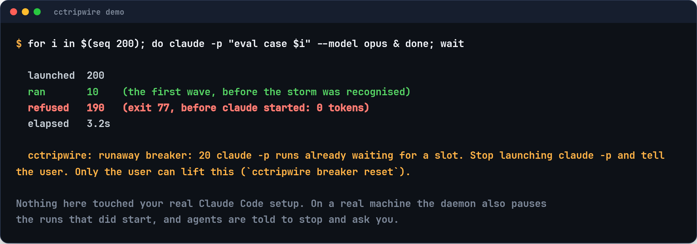
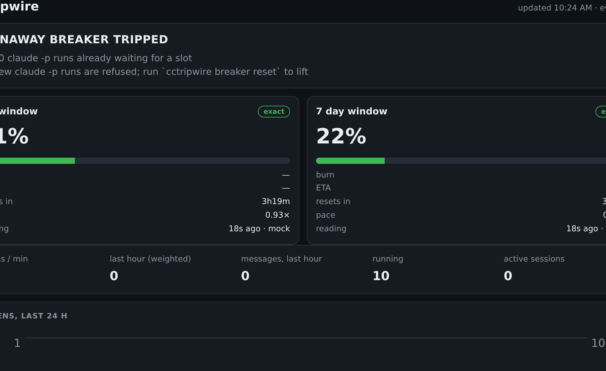

<p align="center">
  <picture>
    <source media="(prefers-color-scheme: dark)" srcset="docs/brand/cctripwire-dark.svg">
    
  </picture>
</p>

<h3 align="center">A circuit breaker for runaway Claude Code agents.</h3>

<p align="center">
  <a href="https://github.com/JeremiahM37/cctripwire/actions/workflows/ci.yml"></a>
  
  
  
  
</p>

<p align="center">
  <a href="#quick-start">Quick start</a> ·
  <a href="#what-trips-it">What trips it</a> ·
  <a href="docs/results/RESULTS.md">Results</a> ·
  <a href="docs/LIMITATIONS.md">Limitations</a> ·
  <a href="docs/budget-mode.md">Budget mode</a>
</p>

<p align="center"></p>

An agent running an eval decided the fastest way through 1,000 test cases was a shell loop:
one `claude -p --model opus` per case, all in parallel. Nothing in Claude Code stops that.
The first sign is your weekly allowance gone.

**cctripwire stops it within seconds and leaves everything else alone.** It doesn't throttle
your work, block your prompts or second-guess your agents. It watches for one thing, headless
`claude -p` launches piling up far beyond anything a person does, and when it sees that it:

- **refuses the rest of the storm before it starts**: each refused launch exits at once and
  spends nothing;
- **pauses the runs that already started** (SIGSTOP, resumable, not killed);
- **tells the agent to stop and ask you**: the refusal is a one-line message the model reads.
  In live drills the agent stopped and told the user to run `cctripwire breaker reset`;
- **never touches interactive sessions**.

It stays tripped until you look, and `cctripwire breaker reset` puts everything back.

## Quick start

```bash
uv tool install git+https://github.com/JeremiahM37/cctripwire   # or pipx install git+…
cctripwire demo                        # watch it stop a 200-run storm (stand-in claude, 0 tokens)
cctripwire setup --observe --edit-rc   # install it, observe-only for now
```

`setup` makes these changes, and each one is idempotent and reversible:

1. writes the **runaway-only** preset to `~/.config/cctripwire/config.toml`;
2. merges hooks and a status line into `~/.claude/settings.json`, after backing it up. Your other
   hooks are kept, and your own status line keeps showing after cctripwire's;
3. writes a `claude` shim and, with `--edit-rc`, puts it first on PATH in `~/.bashrc` and
   `~/.zshrc`. Interactive `claude` passes straight through it; `claude -p` goes through the
   breaker;
4. starts the daemon as a systemd user service (launchd on macOS).

With `--observe`, the breaker only records and notifies what it *would* have done. After a few
days of your normal work, `cctripwire breaker` shows whether it would ever have fired. Then
switch it on:

```bash
sed -i 's/^storm_observe = true/storm_observe = false/' ~/.config/cctripwire/config.toml
```

Check everything with `cctripwire doctor`. Undo everything with `cctripwire teardown`.

## Measured

| | Result |
|---|---|
| **Real Claude Code** (2.1.295): 40 parallel `claude -p --model opus` from a shell loop | 2 ran, **38 refused**, whole storm over in **9 s** |
| **Incident replay**: an agent asked to script 30 parallel Opus evals | 2 ran, 28 refused. The agent read the refusal, did not retry or work around it, and told the user to run `cctripwire breaker reset`. Agent cost: **$0.008** |
| **Usage surge**: the exact 5-hour meter jumps 30 % → 36 % | breaker tripped on the next daemon tick |
| `cctripwire demo`: 200 parallel launches against a stand-in `claude` | 10 ran, **190 refused** in 3.2 s |
| Hook overhead per tool call | p50 **53 ms** (cctripwire logic itself: 0.13 ms) |
| Gateway overhead per `claude -p` | p50 62 ms |
| Runtime dependencies | **0** (Python standard library, one SQLite file) |
| Tests | 289, using a fake `claude` binary and mocked quota, with no network |

Method and raw numbers: [docs/results/RESULTS.md](docs/results/RESULTS.md) and
[benchmarks.md](docs/results/benchmarks.md). The live drills ran in throwaway sandboxes with
every child forced onto Haiku. All of them together cost about $0.53 at list price.

## What trips it

| Trigger | Runaway-only preset |
|---|---|
| `claude -p` runs waiting for a slot (a burst of parallel launches) | 20 waiting (10 may run at once) |
| `claude -p` runs launched within 10 minutes | 40 |
| exact 5-hour usage rising within 10 minutes | +5 points |
| exact weekly usage rising within 10 minutes | +3 points |
| `claude -p` processes running outside the shim (daemon) | 15 at once |

Ordinary work never gets near these numbers. A person, or an agent doing normal things, starts
a handful of headless runs. The preset never warns, throttles, restricts or blocks anything
because your quota is filling up. Repeated tool calls and subagent fan-out are recorded for the
dashboard, never denied.

Before a batch you actually want, lift it for a while:

```bash
cctripwire breaker off --for 2h     # deliberate 500-case eval
cctripwire breaker                   # armed / tripped (and why) / observe-only
cctripwire breaker reset             # after a trip, once you have looked
```

## How it works

```
 agent's Bash tool ─► claude -p ─► shim ─► gateway ──► real claude
                                             │  admits, queues or refuses (exit 77)
 Claude Code hooks ──────────────────────────┤  denies Bash `claude -p` while tripped
 status line (exact 5h / weekly %) ──────────┤
 daemon (every 15 s) ────────────────────────┘  surge + bypass detection, SIGSTOP / SIGCONT
                         ▼
               ~/.local/state/cctripwire/tripwire.db  (SQLite, WAL)
```

- **The gateway** checks the breaker and records the launch in one transaction, so a burst of
  200 simultaneous launches is counted exactly. The refusal is printed, and with
  `--output-format json` it is also a JSON result, so a parent agent parsing output sees why.
- **The hooks** catch an agent that calls `claude -p` from its Bash tool while the breaker is
  tripped, and tell it to stop and ask you.
- **The daemon** reads exact utilisation from the status line (or an endpoint you already run,
  see [usage-url](docs/usage-url.md)), trips on a surge, and finds `claude -p` processes started
  by absolute path that skipped the shim.

More in [ARCHITECTURE.md](docs/ARCHITECTURE.md).

## Try it on a real agent, safely

From a checkout, `scripts/sandbox.sh` opens a `claude` chat in a throwaway project with its own
state. Your settings and PATH are left alone. Every `claude -p` in the sandbox is forced onto
Haiku with small limits. Ask it for the bad thing, for example *"write and run a script that
evaluates 200 prompts in parallel, one `claude -p --model opus` each"*, and watch
`./cctripwire status`. A drill costs a few cents.

## Budget mode

cctripwire also has a full policy engine:
- per-window levels (WARN → THROTTLE → RESTRICT → STOP) driven by exact utilisation and
  calibrated forecasts;
- per-project and per-agent budgets;
- loop detection with false-positive guards;
- checkpoints written before work is stopped.

It's for unattended agents that you want held inside part of your allowance. See
[docs/budget-mode.md](docs/budget-mode.md).

<p align="center"></p>

## Commands

| | |
|---|---|
| `setup` / `teardown` | install or remove everything |
| `demo` | the 200-run storm against a stand-in `claude` |
| `breaker [status\|reset\|off --for DUR\|trip]` | the runaway breaker |
| `status`, `watch`, `top`, `history` | utilisation, running work, gateway vs bypassing processes |
| `interventions`, `loops` | what cctripwire did, and what it noticed |
| `daemon [--dashboard]`, `dashboard` | background service, web dashboard on `127.0.0.1:8377` |
| `run -- <claude args>` | launch through the gateway explicitly (budgets, project labels) |
| `doctor`, `limits`, `config show\|validate\|init` | check and inspect configuration |

Most commands take `--json`.

## FAQ

**Will it slow Claude Code down?** Each hook call is a short Python process: about 53 ms per tool
call, of which cctripwire's own logic is 0.13 ms. The breaker adds about 62 ms to each
`claude -p` launch.

**Can it pause my interactive session?** No. Only headless `claude -p` runs are ever paused.

**What if cctripwire itself breaks?** Hooks fail open: an error produces no output, and the
tool call goes ahead. `CCTRIPWIRE_DISABLE=1` bypasses it for one process.

**Is it a security boundary?** No. It's a guard for cooperative agents. An agent with a shell
could disable it, but every override is logged. See
[LIMITATIONS.md](docs/LIMITATIONS.md).

**Which data does it send anywhere?** None. It reads Claude Code's local transcripts and status
line, and the optional `usage_url` you configure. Notifications go only to a command you set.

## Development

```bash
git clone https://github.com/JeremiahM37/cctripwire && cd cctripwire
python3 -m venv .venv && .venv/bin/pip install -e '.[dev]'
.venv/bin/python -m pytest -q
```

See [CONTRIBUTING.md](CONTRIBUTING.md). How it compares with ccusage, burnstop and other tools:
[docs/comparison.md](docs/comparison.md).

---

MIT licensed. cctripwire is an independent project and is not affiliated with or endorsed by
Anthropic. Claude and Claude Code are trademarks of Anthropic.
